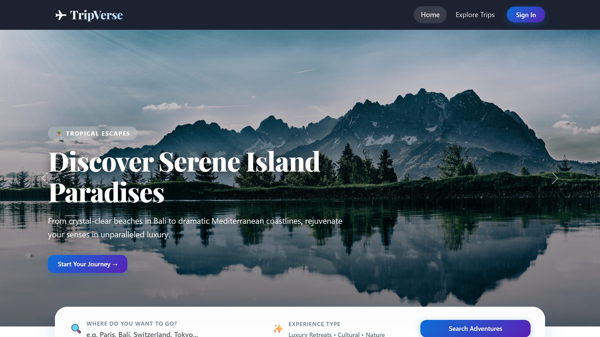
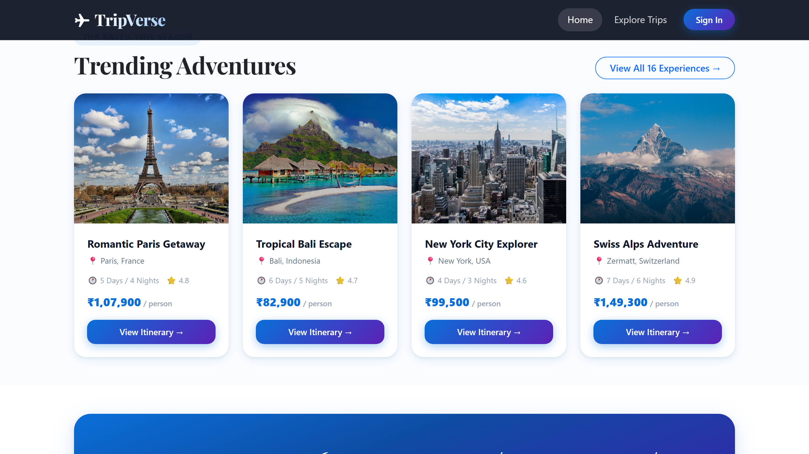
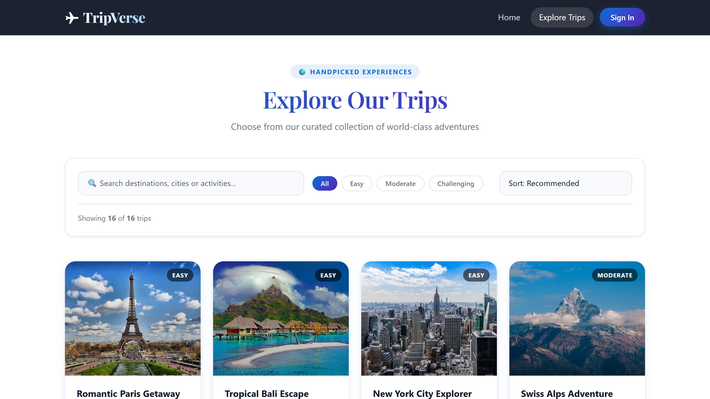
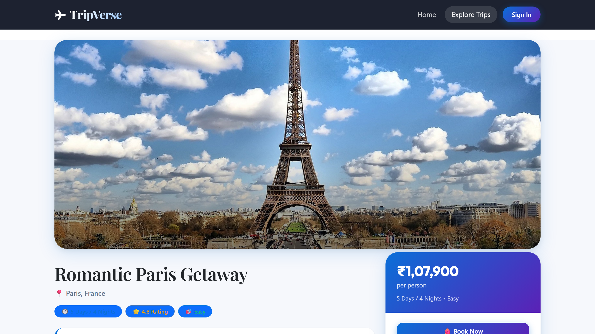
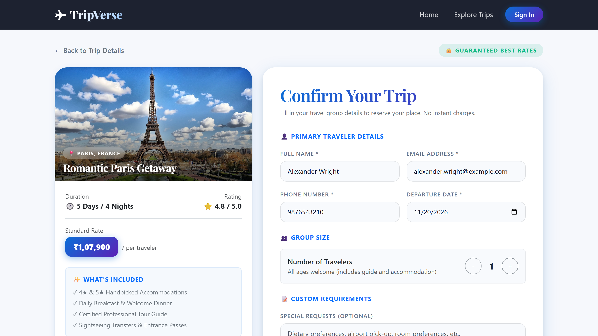
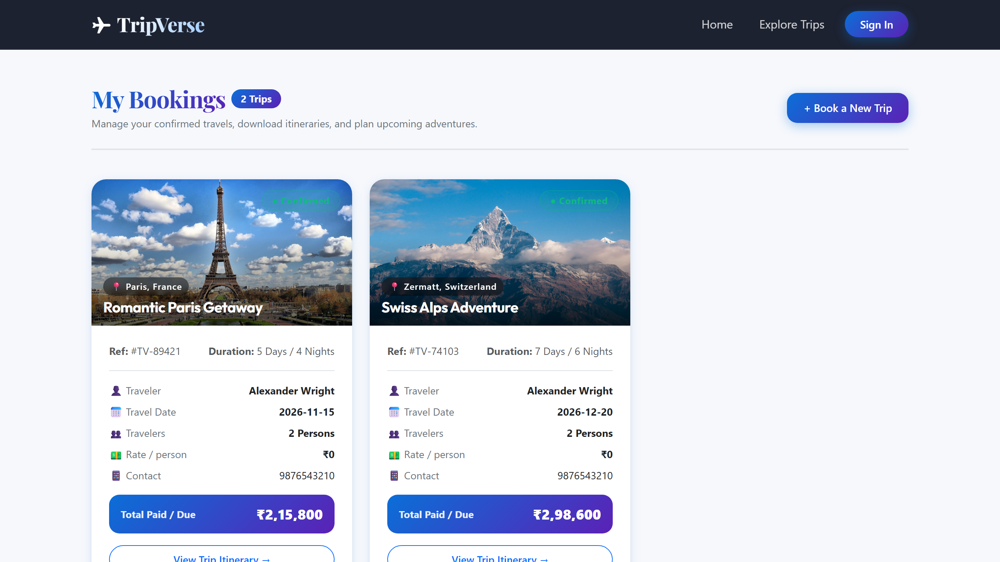
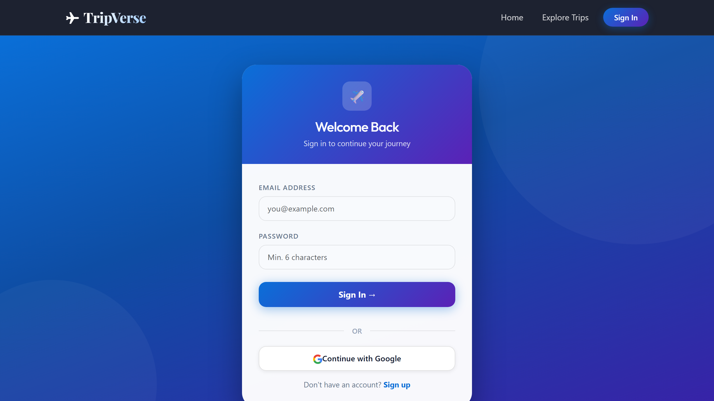

# ✈️ TripVerse - React

> Modern vacation discovery and travel booking web application.

---

## 📸 Project Output Screenshots

### 1. Home Page (Hero & Search)

---

### 2. Trending Adventures & Featured Packages

---

### 3. Explore Trips Catalog (`/trips`)

---

### 4. Trip Details & Itinerary (`/trips/:id`)

---

### 5. Booking & Reservation Engine (`/booking/:id`)

---

### 6. My Bookings Dashboard (`/myBookings`)

📌 About the Project
TripVerse is a travel discovery and booking application designed to make trip planning simple and convenient. Users can explore travel packages, search and filter destinations, review trip details and day-by-day itineraries, calculate booking costs based on the number of travelers, and view their booking history after signing in.

The project combines a React-based user interface with Firebase Authentication and Cloud Firestore for account access and booking data.
🌐 Live Project
- Live website: https://fir-auth-25ed3.web.app/
- GitHub repository: https://github.com/Dabhi-Pratik/TripVerse-React
Note: Some features require a Firebase project configured with the appropriate Authentication providers, Firestore database, and security rules.

✨ Features
🏠 Home Page
- Travel-focused landing page with destination and package highlights.
- Hero section and curated travel content.
- Search entry point to help users find trips.
🧭 Explore Trips
- Browse the available travel packages.
- Search by trip name, destination, country, or description.
- Filter trips by difficulty level.
- Sort packages by recommendation, rating, or price.
- Use URL search parameters to share or revisit a search.
🗺️ Trip Details
- View package information, destination imagery, duration, price, and rating.
- Explore expandable day-by-day itineraries.
- Review trip inclusions, exclusions, and suggested travel seasons.
📝 Booking
- Select the number of travelers and calculate the total price.
- Enter primary traveler and contact details.
- Validate key form fields before submitting.
- Save booking information to Cloud Firestore when configured correctly.
- Display a booking confirmation after a successful submission.
🔐 Authentication
- Register and sign in with email and password.
- Sign in with Google when Google authentication is enabled in Firebase.
- Maintain authentication state using a shared React context.
- Protect booking-related routes from unauthenticated access.
🧳 My Bookings
- View bookings associated with the signed-in user.
- Review trip, traveler, contact, date, and price information.
- Display an empty state when the user has no bookings.
📱 Responsive Interface
- Layouts designed for desktop, tablet, and mobile screens.
- Reusable React components.
- Bootstrap components combined with custom CSS.
- Lazy-loaded pages and loading fallbacks where configured.
🛠️ Tech Stack
Technology	Purpose
React	Component-based user interface
Vite	Development server and production build
JavaScript (ES modules and JSX)	Application logic
React Router	Client-side routing
Bootstrap	Responsive layout and UI components
React-Bootstrap	Bootstrap components for React
CSS	Custom styling and responsive design
Firebase Authentication	User registration and sign-in
Cloud Firestore	Booking data storage
Oxlint	Code linting, if configured in package.json

🧰 Run Locally
Prerequisites
Install the following before starting:
- Node.js — use a version compatible with the project's Vite version.
- npm — included with Node.js.
- A Firebase account if you want authentication and booking storage to work.
1. Clone the repository
git clone https://github.com/Dabhi-Pratik/TripVerse-React.git
cd TripVerse-React
2. Install dependencies
npm install
3. Configure environment variables
Create a .env file in the project root. If the repository includes .env.example, copy it first and then fill in your Firebase project's web-app configuration.
VITE_FIREBASE_API_KEY=your_firebase_api_key
VITE_FIREBASE_AUTH_DOMAIN=your_project_id.firebaseapp.com
VITE_FIREBASE_PROJECT_ID=your_project_id
VITE_FIREBASE_STORAGE_BUCKET=your_storage_bucket
VITE_FIREBASE_MESSAGE_SENDER_ID=your_messaging_sender_id
VITE_FIREBASE_APP_ID=your_firebase_app_id
Replace each placeholder with the matching value from Firebase Console → Project settings → Your apps → SDK setup and configuration.

Important: Vite exposes variables prefixed with VITE_ to browser code. Do not put private service-account credentials or other server-only secrets in these variables. Do not commit your real .env file to GitHub.
4. Configure Firebase
In the Firebase Console:
1. Create a Firebase project, or select an existing one.
2. Register a Web App and copy its configuration into .env.
3. Open Authentication → Sign-in method and enable Email/Password and Google if your app uses both.
4. Create a Cloud Firestore database.
5. Configure Firestore security rules to ensure authenticated users can access only their own booking records.
6. If the application requests a composite index, follow the index link provided by Firebase and create the requested index.
Do not leave Firestore in unrestricted test mode for a production deployment. Confirm that the collection names and field names in your rules match the queries used by the application.
5. Start the development server
npm run dev
Open the local URL printed in your terminal, usually:
http://localhost:5173
6. Create a production build
npm run build
To preview the generated build locally:
npm run preview
📜 Available Scripts
Run the commands supported by your package.json:
Command	Description
npm run dev	Starts the Vite development server
npm run build	Builds the application for production
npm run preview	Serves the production build locally
npm run lint	Runs the configured linter, if this script exists

If a command is unavailable, check the scripts section of package.json and use the scripts defined by your current project version.
🗂️ Project Structure
The main source folders are organized by application responsibility. Your exact files may differ as the project evolves.
TripVerse-React/
├── public/                  # Public assets
├── src/
│   ├── assets/              # Images, icons, and other static assets
│   ├── components/
│   │   ├── forms/           # Authentication and booking forms
│   │   ├── pages/           # Home, trips, trip details, bookings
│   │   └── ui/              # Shared UI components
│   ├── config/
│   │   └── firebase.js      # Firebase initialization
│   ├── context/
│   │   └── AuthContext.jsx  # Shared authentication state
│   ├── data/
│   │   └── Trips.js         # Trip/package data
│   ├── router/
│   │   ├── MainLayout.jsx   # Shared application layout
│   │   └── ProtectedRoute.jsx
│   ├── App.jsx              # Application routes
│   ├── App.css              # Application styles
│   ├── index.css            # Global styles
│   └── main.jsx             # React entry point
├── .env.example             # Example environment variables, if included
├── .gitignore
├── index.html
├── package.json
├── vite.config.js
└── README.md
🧭 Main Application Routes
Route	Purpose	Access
/	Home page and featured travel packages	Public
/trips	Search and browse trips	Public
/trips/:id	View trip details and itinerary	Public
/booking/:id	Book a selected trip	Sign-in required
/auth	Sign in or register	Public
/myBookings	View personal booking history	Sign-in required
*	Not-found page	Public

Routes are listed according to the current project documentation. If you change route paths in App.jsx, update this table to match.
🗄️ Booking Data
TripVerse uses Cloud Firestore for booking persistence. The documented booking records may include fields such as:
Field	Description
userId	Firebase UID of the user who made the booking
tripId	ID of the selected package
tripName	Name of the trip
destination	Destination
name	Primary traveler's name
email	Contact email
phone	Contact phone number
date	Selected departure date
person	Number of travelers
total	Calculated booking total
request	Optional special requests
createdAt	Booking creation timestamp

Use the actual fields written by your booking form as the source of truth. The app's Firestore queries, database documents, and security rules must agree on field and collection names.
🔒 Security Notes
- Keep .env out of version control and include it in .gitignore.
- A Firebase web API key is not a substitute for database security rules.
- Require authentication for personal booking data.
- Enforce ownership checks in Firestore rules using the authenticated user's UID.
- Validate important values before writing them to Firestore.
- Never deploy with unrestricted Firestore rules.
- Do not publish Firebase service-account keys or other private credentials.
🚀 Deployment
The project is currently available at fir-auth-25ed3.web.app.

To deploy your own version using Firebase Hosting:
1. Install the Firebase CLI if it is not already installed.
2. Sign in with your Google account.
3. From the project root, run firebase init hosting and select the correct Firebase project.
4. Set the public directory to dist for a standard Vite build.
5. Configure the single-page application rewrite if prompted, so React Router routes can load directly.
6. Build and deploy:
npm run build
firebase deploy
Make sure your Firebase Hosting configuration serves the generated dist folder and that the correct environment variables are available at build time.
🛣️ Possible Future Improvements
- [ ] Add a payment gateway such as Razorpay or Stripe.
- [ ] Generate downloadable booking confirmations or PDF tickets.
- [ ] Add a wishlist for favorite destinations.
- [ ] Let verified travelers submit ratings and reviews.
- [ ] Add booking cancellation and modification workflows.
- [ ] Improve accessibility and automated testing.
🤝 Contributing
Suggestions and contributions are welcome.
1. Fork the repository.
2. Create a feature branch:
   git checkout -b feature/your-feature
3. Commit your changes:
   git commit -m "Add: describe your change"
4. Push the branch:
   git push origin feature/your-feature
5. Open a Pull Request with a clear explanation of your changes.
👨‍💻 Author
Dabhi Pratik
- GitHub: @Dabhi-Pratik
- Project repository: TripVerse-React
- Live demo: fir-auth-25ed3.web.app

---

### 7. User Authentication (`/auth`)

  

